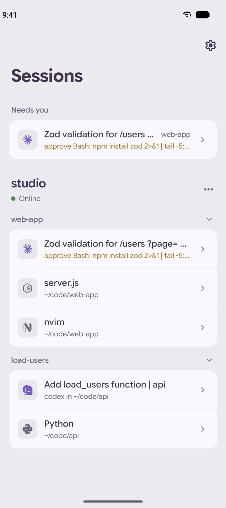
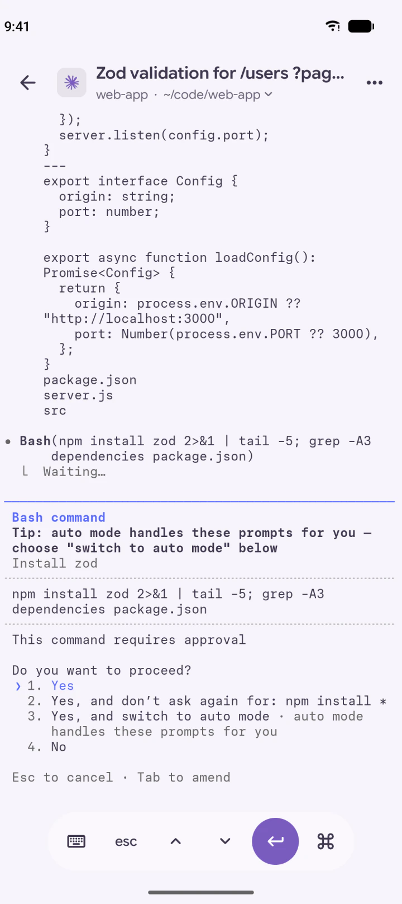
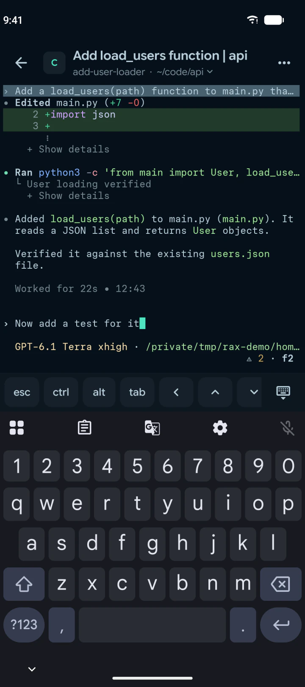

# Rax

Rax is an Android app for [Rex](https://www.superlogical.com/rex), the terminal multiplexer for
Mac. It shows the sessions and tabs running in Rex on your computers, and opens any of them as a
live terminal on your phone.

<p>
  
  
  
</p>

- Rax runs its own Tailscale node, so your whole phone doesn't have to run a VPN.
- We've also bundled all the familiar Rex themes straight from the official clients!

## Install

Download the APK from the newest release on the
[Releases page](https://github.com/uditkarode/rax/releases). Rax needs Android 13 or later.

## Connect to your computer

### On the same network

Start Rex so the phone can reach it:

```
rex server start --extra-listen :7297 --allow-anonymous
```

In Rax, add a host with the computer's address, for example `192.168.1.20:7297`. Anyone who can
reach this port can use your Rex, so do this only on a network you trust.

### Over Tailscale

Turn on Tailscale in Rex:

```
rex server tailscale on
```

In Rax, open Settings, then Tailscale, and sign in with the same Tailscale account. Rax lists the
Rex servers it finds, and you tap one to add it.

## Credits

Rax draws the terminal with [libghostty-android](https://github.com/SagerNet/libghostty-android)
and [Ghostty](https://ghostty.org), connects over [Tailscale](https://github.com/tailscale/tailscale),
and shows program logos from [Simple Icons](https://simpleicons.org) and
[Lobe Icons](https://github.com/lobehub/lobe-icons). The color themes come from
Rex. Settings, then Acknowledgements, lists every license.
