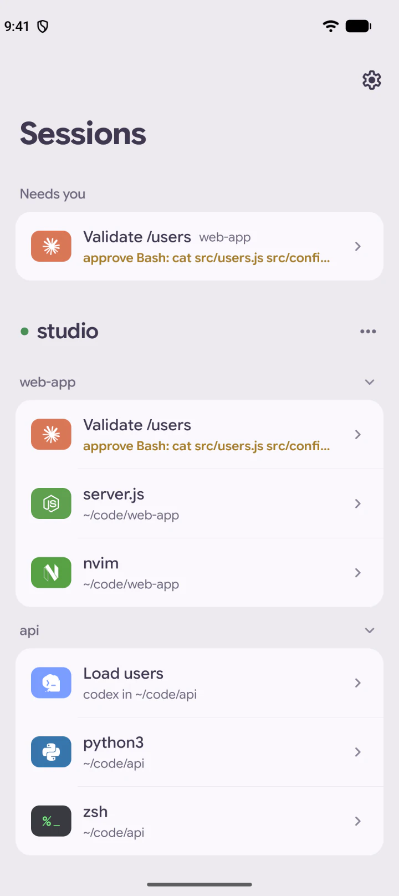

# Rax

An Android client for [Rex](https://www.superlogical.com/rex), so you can check on your terminal sessions from your phone without hauling your laptop around.

<p>
  
  
  
</p>

Rax lets you browse your sessions, open a live terminal, send files, and get notified when a program like Claude Code or Codex needs you. It also bundles its own Tailscale node, so it reaches your tailnet without turning on a VPN for your whole phone.

## Install

Download the latest APK from the [Releases page](https://github.com/uditkarode/rax/releases).

Rax requires Android 10 or later. After the first install, the built-in updater handles new releases.

## Connecting to your computer

### Over Tailscale

If you want access away from home, this is the easiest option.

Turn on Tailscale in Rex on your computer:

```bash
rex server tailscale on
# or from the Rex GUI
```

Open **Settings → Tailscale** in Rax and sign in. Any Rex servers on your tailnet will show up there.

You can also pair with a QR code. Run this on your computer, then tap **Add host → Scan QR code** in Rax:

```bash
rex server tailscale pair
```

If you already use the Tailscale app on your phone, turn on **Use the Tailscale app** in **Settings → Tailscale** instead. Then add your computer using its MagicDNS name, like `studio-rex.tail1234.ts.net`.

### Over SSH

If you can SSH into your computer and Rex is installed there, you don't need Tailscale or any extra open ports.

Add a host with an address like `ssh://you@devbox`, or `ssh://you@devbox:2222` for a custom port. If the Rex server isn't running yet, Rax starts it automatically.

You can sign in with:

- **Rax's key**: Rax generates a key on your phone and keeps the private half there. Add the public key it shows to `~/.ssh/authorized_keys` on your computer.
- **Your key**: paste your own private key into Rax.
- **Password**: your regular SSH password.

Keys and passwords stay encrypted on your phone. If you want to reach SSH over your tailnet, turn on **Through Tailscale** on the host.

### On the same network

Start Rex with an open port on your computer:

```bash
rex server start --extra-listen :7297 --allow-anonymous
# or from the Rex GUI
```

In Rax, add a host with your computer's local address, like `192.168.1.20:7297`.

Only do this on a network you trust. Anyone who can reach that port has access to Rex.

## Credits

The idea for Rax came from [RexPocket](https://github.com/leizhiyuan/rexpocket), an earlier Android client for Rex.

Rax is built with:

- [libghostty-cmp](https://github.com/xchacha20-poly1305/libghostty-cmp) and [Ghostty](https://ghostty.org) for the terminal
- [Tailscale](https://github.com/tailscale/tailscale) for tailnet connections
- [ZXing](https://github.com/zxing/zxing) for QR code scanning
- [Simple Icons](https://simpleicons.org), [Lobe Icons](https://github.com/lobehub/lobe-icons), and the respective projects for program logos
- Rex for the color themes

You can read all the open-source licenses in **Settings → Acknowledgements**.
