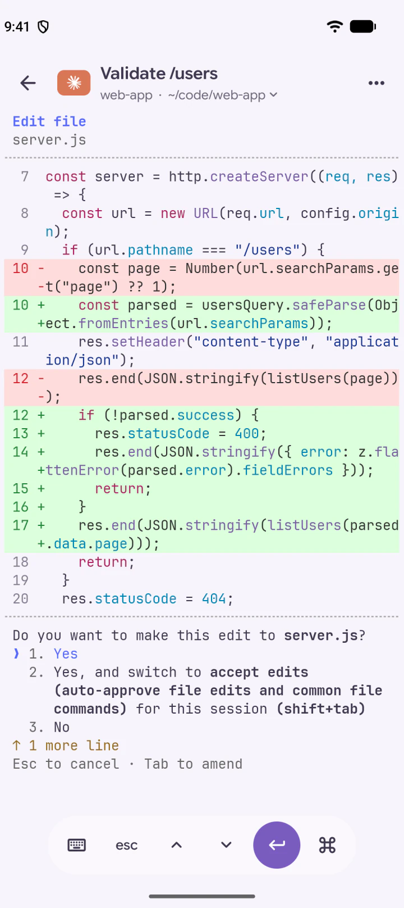
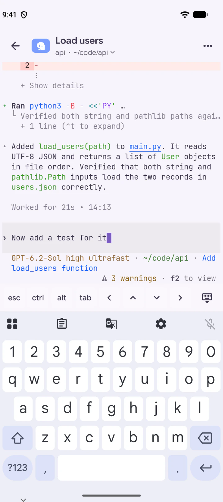

# Rax

Rax is an Android client for [Rex](https://www.superlogical.com/rex), the terminal multiplexer.  

<p>
  
  
  
</p>
  
Rax can run an in-app Tailscale node, so you don't need Tailscale running on the whole phone!

## Install

Download the APK from the newest release on the
[Releases page](https://github.com/uditkarode/rax/releases).  
  
Rax needs Android 10 or later. Future updates can use the in-app updater.

## Connect to your computer

### On the same network

Start Rex:

```bash
rex server start --extra-listen :7297 --allow-anonymous
# or from the GUI
```

In Rax, add a host with the computer's address, for example `192.168.1.20:7297`. Anyone who can
reach this port can access Rex, so do this only on a network you trust.

### Over Tailscale

Turn on Tailscale in Rex:

```bash
rex server tailscale on
# or from the GUI
```

In Rax, open Settings → Tailscale, and sign in to Tailscale. You'll see listed the
Rex servers it finds on your tailnet.

You can also pair with a QR code. Run this on the computer, then tap Add host → Scan QR code in Rax:

```bash
rex server tailscale pair
```

If the Tailscale app already runs on your phone, turn on "Use the Tailscale app" there instead. Rax
then reaches your tailnet through it. Add the computer as a host with its MagicDNS name, for
example `studio-rex.tail1234.ts.net`.

### Over SSH

If you can log in to the computer with SSH, Rax can reach Rex through SSH, with no extra port and no
Tailscale. Add a host with an address like `ssh://you@devbox`, or `ssh://you@devbox:2222` for another
port. Rax signs in with one of:

- Rax's key, which Rax makes on the phone and which never leaves it. Add the key that Rax shows to
  `~/.ssh/authorized_keys` on the computer.
- Your own private key, pasted into Rax.
- Your password.

Rax keeps the key and the password encrypted on the phone. Rex must be installed on the computer.
Rax starts the Rex server there if it isn't running. Turn on "Through Tailscale" to reach the
computer's SSH over your tailnet.

## Credits

The idea for Rax comes from [RexPocket](https://github.com/leizhiyuan/rexpocket), an earlier
Android client for Rex.

Rax draws the terminal with [libghostty-cmp](https://github.com/xchacha20-poly1305/libghostty-cmp)
and [Ghostty](https://ghostty.org), connects over [Tailscale](https://github.com/tailscale/tailscale),
reads QR codes with [ZXing](https://github.com/zxing/zxing), and shows program logos from [Simple Icons](https://simpleicons.org) and
[Lobe Icons](https://github.com/lobehub/lobe-icons). The color themes come from
Rex. Settings → Acknowledgements lists licenses for everything used.
